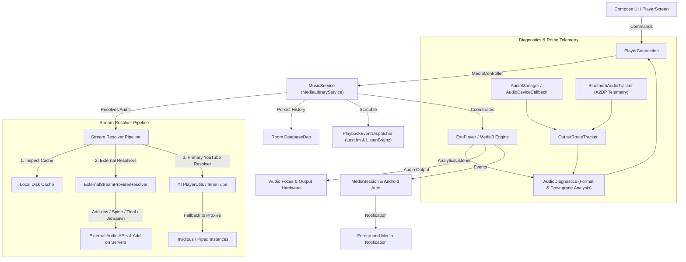

# Playback Engine and Media Architecture

This document describes the media playback architecture, service lifecycle, queue coordination, caching mechanisms, and stream resolution pipeline in Rift.

---

## 1. Architecture Overview



---

## 2. Core Components

### `MusicService` (`playback/MusicService.kt`)
`MusicService` extends `MediaLibraryService` and operates as an Android foreground service. Its responsibilities comprise:
- **ExoPlayer Lifecycle:** Initialisation, audio offload, audio attributes, playback speed, pitch adjustments, and thorough resource disposal in `onDestroy()`.
- **MediaSession and Android Auto:** Broadcasts playback state, metadata, and playlist trees to the system notification shade, lock-screen controls, and Android Auto dashboards.
- **Audio Focus Management:** Automatically ducks or pauses audio when phone calls arrive, navigation prompts speak, or other audio applications request transient focus.
- **Queue Coordination:** Manages the sequential play queue, shuffle order, repeat modes (`None`, `All`, `One`), and automated queue continuation based on similar tracks.
- **Non-Blocking Preference Observation:** All preference parameters (e.g. repeat mode, crossfade durations, persistent queue enablement) are cached in-memory (`cachedRepeatMode`, `cachedPersistentQueue`, `cachedAutoLoadMore`) and maintained asynchronously via a single `distinctUntilChanged` DataStore flow collector. Main-thread execution in `Player.Listener` callbacks is strictly non-blocking.
- **Asynchronous Cache Eviction:** Stream cache deletion on quality reload executes off the main thread via coroutines on `Dispatchers.IO`, preventing UI frame drops.

### `PlayerConnection` (`playback/PlayerConnection.kt`)
`PlayerConnection` provides a reactive bridge between Jetpack Compose UI state and the background `MusicService`:
- Uses AndroidX Media3 `MediaBrowser` and `MediaController` interfaces.
- Exposes Kotlin `StateFlow` streams conveying playback position, buffered duration, active track metadata, playback error conditions, and shuffle/repeat states.
- Executes bounded asynchronous commands without blocking the Compose composition pipeline.

---

## 3. Stream Resolution Pipeline

When a track is prepared for playback:

1. **Local Disk Cache Inspection:** The player checks whether complete or partial media chunks exist in the offline ExoPlayer simple cache directory.
2. **External Provider Resolution (`ExternalStreamProviderResolver.kt`):**
   - **HTTP Streaming Add-ons:** If configured, modular add-on sources are queried first via `AddonSource`. Manifest caching, in-flight deduplication (`SharedCalls`), and rate-limit backoff protect external endpoints. If the candidate track supplies a direct `streamURL`, it is dispatched immediately. `TrackMatcher` validates duration and title, rejecting remixes or live versions to prevent silent track mismatches.
   - **External Hi-Fi Sources:** If enabled by explicit user opt-in (`EnableSpineKey`, `EnableTidalStreamingKey`, `EnableJioSaavnKey`), secondary stream providers (Spine, Tidal, JioSaavn) are evaluated in sequence.
   - **Scoped Metadata Fetching:** YouTube metadata queries (`YouTube.next(videoId)`) are performed via a scoped lazy provider (`getYtMetadata()`). The first external provider triggers the lookup; subsequent fallback providers reuse the cached title, artist, and duration instantly in 0 ms.
3. **Primary YouTube Resolution (`YTPlayerUtils.kt`):**
   - Direct streaming URLs are resolved from YouTube Music via InnerTube endpoints, selecting optimal audio streams (WebM/Opus or M4A/AAC).
   - **Terminal Error Abort:** The resolver inspects response payloads using `BotDetectionMitigator.isUniversalTerminalError()`. Unrecoverable terminal states (e.g. deleted videos, copyright strikes, private clips) terminate fallback iteration immediately, avoiding 15–30-second multi-client retry delays. Recoverable network or throttling errors retain standard multi-client rotation.

---

---

## 4. Audio Diagnostics and Hardware Route Telemetry

Rift incorporates a truth-first telemetry pipeline providing complete transparency into the audio rendering pipeline:

```
Media3 Decoder Format (AnalyticsListener)
  └─► AudioDiagnostics (Codecs, Sample Rate, Bit Depth, Bitrate)
        ├─► Downgrade Detection (Lossless claim vs lossy/downsampled input)
        └─► OutputRouteTracker (AudioDeviceCallback + BluetoothAudioTracker)
              └─► UI Layer (AudioQualityBadge & ShowMediaInfo dialog)
```

- **Decoder Telemetry:** Captured on `AnalyticsListener.onAudioInputFormatChanged()`. Reports actual media codec (`audio/flac`, `audio/opus`, `audio/mp4a-latm`), channels, sample rate, bit depth, and bitrate.
- **Downgrade Analysis:** When a source advertises lossless audio but the decoder is fed lossy Opus/AAC or downsampled audio, `AudioDiagnostics` flags the stream as `DOWNGRADED` with visual indicators in the player UI.
- **Hardware Sink Classification:** Identifies active physical audio sinks:
  - `Internal Speaker` (default phone transducers)
  - `Wired Line/Headset` (3.5 mm / USB-C analog adapters)
  - `USB Audio Out` (direct USB DAC / external sound card)
  - `HDMI / Digital Multi-Channel`
- **Bluetooth A2DP Codec Telemetry:** Interrogates Android Bluetooth profile proxy (`BluetoothA2dp`) to capture negotiated Bluetooth codecs (LDAC, aptX HD, aptX Adaptive, AAC, SBC, Samsung Seamless Codec) along with operating sample rates.
- **Non-Interfering Architecture:** Telemetry runs entirely on background listeners and UI observation flows. It **never** blocks, halts, or alters audio execution.
- **Technical Limitations:** Telemetry reflects the parameters reported by the Android framework. Audio is output through Android's standard AudioTrack/AudioFlinger pipeline, where system resampling to 48 kHz may occur depending on device hardware and OEM audio policies. No unsupported "bit-perfect" or hardware bypass promises are made.

---

## 5. Per-Network Quality Resolution & Network Handover

`MusicService` reactively evaluates audio quality by observing DataStore preferences and network state:

1. **Preference Hierarchy:**
   - If `DataSaverEnabledKey` is active $
ightarrow$ forces `AudioQuality.LOW`.
   - Checks active network transport:
     - `TRANSPORT_CELLULAR` $
ightarrow$ resolves `MobileAudioQualityKey`.
     - `TRANSPORT_WIFI` or `TRANSPORT_ETHERNET` $
ightarrow$ resolves `WifiAudioQualityKey`.
     - Ambiguous / unmetered hotspot $
ightarrow$ falls back to `connectivityManager.isActiveNetworkMetered`.
   - If per-network preference is unset (`null`), falls back to global `AudioQualityKey`.
   - If global setting is unconfigured, defaults to `AudioQuality.AUTO`.
2. **Seamless Network Transition:**
   - `NetworkConnectivityObserver` listens to `onCapabilitiesChanged` in addition to available/lost events.
   - When transitioning from Wi-Fi to cellular (or vice-versa), `MusicService` recalculates the target quality.
   - If the resolved quality level actually differs and media is actively playing, the stream is re-fetched and resumed seamlessly at the same playback position; otherwise, playback continues without reload.

## 6. Audio Effects and Processing

- **DJ Mode and Transitions:** Automated beat tracking (`BeatTracker.kt`), musical key analysis (`KeyDetector.kt`), and energy profiling (`EnergyProfile.kt`) calculate seamless crossfade transition points between successive tracks.
- **Audio Normalisation:** ReplayGain and LoudnessEnhancer parameters normalise volume discrepancies across diverse source streams.
- **Smart Crossfade:** Soft volume interpolation between outgoing and incoming audio streams.
- **Multi-Band Equaliser:** User-adjustable frequency bands with preset configurations (Bass Boost, Vocal, Electronic, Acoustic) and custom profile persistence.

---

## 7. Download Management & Lossless Export

Offline caching and deliberate track downloads are orchestrated by `DownloadService` and ExoPlayer `DownloadManager`. Downloaded assets reside within application-private storage, indexed by Room database entries, and seamlessly substituted for remote streams whenever the device is offline.

### Lossless FLAC File Export (`SongExporter.kt` & `FlacTagger.kt`)
- Users can export downloaded or cached tracks directly to external storage via Android's Storage Access Framework.
- If the track was cached as genuine lossless FLAC (`$songId#flac`), `SongExporter` verifies the `fLaC` stream magic and invokes `FlacTagger` to embed standard Vorbis comment tags (TITLE, ARTIST, ALBUM), front cover art, and synchronized lyrics directly into the exported `.flac` file.
- Raw audio frame streams are copied byte-for-byte untouched, guaranteeing zero quality degradation or re-encoding artifacts.
- Non-FLAC sources (e.g. YouTube Opus/AAC streams) are cleanly remuxed/transcoded to `.m4a` format without mislabeling them as FLAC.


---

## 8. Queue Management and Media3 Reordering

### Direct Long-Press Drag-and-Drop Reordering
The queue screen (`Queue.kt`) supports direct long-press drag-and-drop reordering without requiring a permanent unlock or edit button:
- **Interaction Model:** Uses Compose's `detectDragGesturesAfterLongPress`. Long-pressing any queue item elevates it visually (elevation shadow, border highlight) and provides immediate haptic feedback (`HapticFeedbackType.LongPress`).
- **Edge Auto-Scrolling:** When an item is dragged within the top or bottom 120 dp of the scrollable queue viewport, the list automatically scrolls smoothly in that direction, enabling effortless reordering in large queues.
- **Accessibility:** TalkBack accessibility semantics provide custom actions ("Move up", "Move down") on each queue row, respecting boundary limits (`index > 0`, `index < size - 1`).

### Media3 Shuffle-Aware Timeline Coordination
Reordering behaves correctly across both playback modes:
- **Linear / Unshuffled Mode:** Moving an item executes `player.moveMediaItem(fromIndex, toIndex)` directly on the Media3 timeline. Active playback continues without interruption, rebuffering, or restart. If the currently playing item is moved, `player.currentMediaItemIndex` updates automatically while playback continues.
- **Shuffle Mode (`DefaultShuffleOrder`):** In shuffle mode, modifying the underlying timeline windows would disrupt the shuffled playback sequence. Instead, Rift calculates the new permutation and invokes `player.setShuffleOrder(newShuffleOrder)`. The displayed queue and subsequent playback transitions match the user's dragged order, while existing playback continues seamlessly.
- **Duplicate Track Support:** Media items in the queue are keyed using distinct timeline window indices, allowing identical tracks with the same `mediaId` to be reordered independently without key collision.

---

## 9. Autoplay, Radio Continuation, Recommendation Post-Processing & Project ASI 1.0

### Autoplay Infinity Toggle
- The queue header and player controls feature an accessible Autoplay toggle chip (infinity icon).
- Controlled reactively via `AutoPlayKey` in DataStore preferences.
- When enabled and the active playlist reaches its end, `MusicService` automatically fetches continuation tracks via InnerTube automix (`YouTube.next(...)`) with seamless fallback to official YouTube Radio stations (`RDAMVM...`).

### Recommendation Post-Processor (`RecommendationPostProcessor.kt`)
Incoming recommendation candidates pass through a deterministic multi-stage filtering and ranking engine:
1. **Strict Upfront Exclusion:**
   - Excludes the currently playing media ID.
   - Excludes any tracks already queued in upcoming positions.
   - Excludes disliked tracks (matching exact track ID or cross-provider normalized title, primary artist, and duration within ±15s). **Disliked tracks are never relaxed.**
2. **Cross-Provider Deduplication:** Matches equivalent tracks across YouTube and external providers using fuzzy title/artist matching and duration tolerance.
3. **Two-Phase Progressive Selection Strategy:**
   - The candidate pool is partitioned into a **fresh pool** (tracks not in the recent 40-track playback history) and a **recent cooldown pool**.
   - **Phase 1:** Selects up to `targetCount` (default 25) exclusively from the fresh candidate pool.
   - **Phase 2:** Only if the fresh pool cannot satisfy `targetCount` does the engine progressively expand into the recent cooldown pool for the remainder.
   - Fresh candidates are mathematically guaranteed to precede recent tracks regardless of original candidate indices.
4. **Artist and Album Diversity Ordering:**
   - Consecutive tracks avoid identical primary artists (penalty: 1,000) and albums (penalty: 200).
   - A sliding window of 5 tracks penalizes artist clustering (penalty: 400 per repeat).
   - **Artist Radio Mode:** When $\ge 70\%$ of candidates belong to the seed artist, artist penalties are relaxed to maintain true artist-radio relevance.
   - Diversity state is seamlessly passed across the fresh-to-recent pool transition.

---

## 10. Persistent Disliked Songs (`DislikeManager.kt`)

Rift provides a first-class dislike mechanism for user preference tuning:
- **Unified Menu Parity:** The "Dislike song" / "Remove dislike" action is available directly in both the Player screen's three-dot menu and the Queue item menu with consistent reactive state, icon cues, and toast feedback.
- **Behavior:** Immediately skips the playing track, excludes it from upcoming recommendations, and persists the track into Room schema version 38 (`disliked_song` table).
- **Cross-Provider Matcher:** Stores both exact IDs and normalized tokens (`cleanTitle`, `primaryArtist`) to block identical songs even if recommended under a different YouTube upload ID or provider.
- **Management & Restoration:** A dedicated **Disliked Songs** screen in Settings (`Settings > Disliked Songs`) allows users to review their full dislike history and restore tracks with one tap.

---

## 11. Playback Reliability, Error Recovery & Structured Diagnostics

### Intent-Preserving State Management (playWhenReady vs isPlaying)
In AndroidX Media3, player.isPlaying evaluates to 	rue strictly when playbackState == STATE_READY && playWhenReady && !suppressed. During buffering states (STATE_BUFFERING), player.isPlaying is alse despite active user intent to listen.
- **Dynamic Network & Audio Quality Reloads:** When network interfaces transition between Wi-Fi and Cellular or user preferences update, stream reload routines evaluate al wasPlaying = player.playWhenReady || player.isPlaying. If active intent exists, player.play() is explicitly invoked following re-preparation, preventing silent mid-playback halts.
- **Audio Focus Management:** On transient focus loss (AUDIOFOCUS_LOSS_TRANSIENT and AUDIOFOCUS_LOSS_TRANSIENT_CAN_DUCK), playback state is preserved via wasPlayingBeforeAudioFocusLoss = player.playWhenReady || player.isPlaying. When audio focus is regained (AUDIOFOCUS_GAIN), playback resumes automatically even if focus was interrupted during track buffering.
- **AudioTrack Recovery:** Renderer failures (ERROR_CODE_AUDIO_TRACK_WRITE_FAILED and INIT_FAILED) safely reset the audio sink, pause, settle for 3 seconds, re-seek, re-prepare, and resume playback via player.play() whenever the user was actively playing.
- **Stream Recovery Routines:** Recovery procedures (handleParsingError, handleGenericIOError, handleRangeNotSatisfiableError, handlePageReloadError, handleExpiredUrlError, and 	riggerLosslessFallback) capture shouldResume = player.playWhenReady || player.isPlaying || wasPlayingBeforeAudioFocusLoss and resume playback upon re-preparing rather than stalling out in STATE_READY.

### Open-Ended Delivery for External Streaming Providers
- YouTube streams use chunked subrange downloads (CHUNK_LENGTH = 10MB) aligned with YouTube itag CDN semantics.
- External streaming providers (Tidal, Spine, JioSaavn, HTTP Add-on) return direct static media URLs. To eliminate premature end-of-input (C.RESULT_END_OF_INPUT) and sudden mid-track cutoffs on non-chunked CDNs, all external providers are exempted from CHUNK_LENGTH truncation and delivered in open-ended HTTP requests (spec.withUri(streamUrl.toUri())).

### Expired Streaming URL Detection (HTTP 403 & 410)
- Expired signed URLs from YouTube / Google Video CDNs return HTTP 410 (Gone) or HTTP 403 (Forbidden). Both status codes are recognized by isExpiredUrlError(), triggering cipher cache invalidation, fresh URL resolution, and position resumption without unrecoverable error fallbacks.

### In-Memory Circular Diagnostics Buffer (PlaybackDiagnostics)
- Retains the 100 most recent playback lifecycle events in a thread-safe ring buffer (ConcurrentLinkedDeque).
- Captures timestamp, session ID, media ID, title, provider name, event type (STATE_CHANGE, ERROR, RECOVERY_ATTEMPT, AUDIO_FOCUS, NETWORK_CHANGE, PROVIDER_SELECTION), playback state, playWhenReady, isPlaying, and structured diagnostic details (error codes, HTTP status, exception class names).

---

## 12. Project ASI 1.0 — Adaptive Session Intelligence (Feedback & Taste Engine)

Rift incorporates **Project ASI 1.0 (Adaptive Session Intelligence)** to provide context-aware, locally-learned listening feedback and session tracking without external telemetry or heavy ML dependencies.

### Centralized Feedback Classification (`ASIFeedbackCollector.kt`)
To avoid fragile timing heuristics or assuming intent from Media3 transition codes alone, ASI instruments explicit user command pathways across UI, MediaSession controllers, Notifications, and Bluetooth AVRCP (`CommandOriginRegistry.kt`):
- **Natural Completion:** Track boundary reached via `AUTO_TRANSITION` or continuous play time $\ge 80\%$ duration. Positive confirmation signal.
- **Explicit User Skip:** User tapped Next in UI, system notification, or Bluetooth controller. Sub-classified into early skips ($<15\text{s}$, strong negative) and casual skips ($15\text{--}30\text{s}$, moderate negative).
- **Manual Track Selection:** User tapped an explicit song from search, album, or queue. Taste impact on the previous track is **strictly neutral (0.0)**.
- **Replay:** Repeated playback of the same track. Strong positive signal (+1.8).
- **Queue Modification:** Track removal or queue reordering. Neutral taste impact.
- **System Interruption:** Involuntary interruptions from codec errors, HTTP 410 URLs, lossy/lossless stream stalls, or audio focus loss. **Strictly neutral (0.0 penalty)**.
- **Unclassified Transitions:** Seeks without a verified user command record are treated as neutral transitions to prevent unverified preference assumptions.
- **Duplicate Suppression:** Monotonic event token registry suppresses identical transition events within 2,000ms.

### Bounded Persistent Negative-Signal Journal (`NegativeSignalJournal.kt`)
- **Persistence:** Negative skip signals are persisted atomically to a dedicated Jetpack DataStore journal (`asi_negative_journal`), surviving service and app process death.
- **Zero Room Schema Migrations:** Completely avoids Room schema changes (database remains at version 38).
- **Cross-Provider Track Identity (`CanonicalTrackId.kt`):** Cleans title bracket noise and normalizes primary artists (stripping YouTube Topic suffixes) with a $\pm 15\text{s}$ duration tolerance.
- **Pruning & TTL:** Bounded to a maximum of 200 entries and expires records older than 14 days (configurable via `ASIConfig`).

### Session Profile & Taste Modeling (`ASISessionProfile.kt`, `ASITasteProfile.kt`)
- **Gradual Session Adaptation:** When the user manually selects another track, session context is partially preserved (retaining up to $65\%$ of recent sliding context) to maintain session continuity while shifting momentum toward the new track. Consecutive skip friction is reset. Cold resets occur only after 30 minutes of inactivity.
- **Exponential Time Decay:** Historical listen events decay with a configurable half-life ($t_{1/2} = 30\text{ days}$).
### Trajectory Optimization, Multi-Source Candidates & Fallback (`ASIManager.kt`)
- **Multi-Source Pooling (`ASICandidateGenerator.kt`):** Concurrently retrieves candidates from YouTube Music radio continuations, artist discovery endpoints, and local library favorites, applying hard exclusions (dislikes, negative journal, queue duplicates) and canonical track deduplication.
- **Explainable 5-Dimension Scoring (`ASIScorer.kt`, `ASITransitionEvaluator.kt`):** Personalizes ranking via enjoyment, session vibe alignment, harmonic/energy transition smoothness, freshness cooldown, and discovery tolerance.
- **Bounded Beam Search (`ASISequenceOptimizer.kt`):** Evaluates multi-track listening paths (width $K=4$, horizon $H=5$) to prevent repetitive artist clusters, album runs, and jarring energy swings without greedy dead-ends.
- **Fail-Safe Fallback:** Any candidate generation timeout (1,500ms), overall recommendation timeout (2,000ms), or unexpected error safely returns `null`, causing `MusicService` to transparently fall back to `RecommendationPostProcessor` with zero interruption to playback.
- **Complete Specification:** See [ASI.md](ASI.md).
