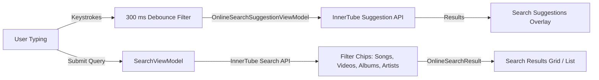
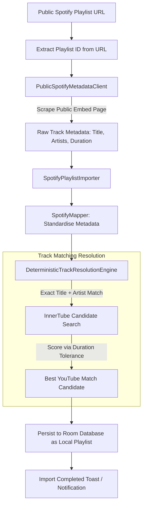
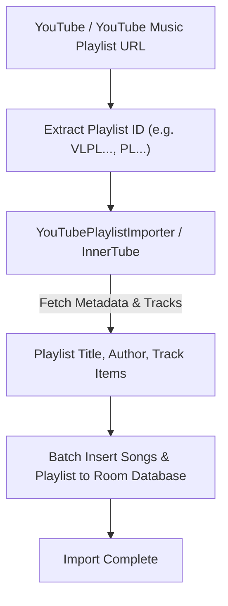

# Search and Playlist Import Pipeline (Spotify & YouTube Music)

This document describes the search architecture, query debouncing mechanisms, and the public playlist import pipelines for Spotify and YouTube Music.

---

## 1. Search Pipeline

### Search Engineering Characteristics
- **300 ms Keystroke Debouncing:** In `OnlineSearchSuggestionViewModel.kt`, query flows apply `.debounce { if (it.isEmpty()) 0L else 300L }`. Empty strings trigger an immediate 0 ms reset, whilst non-empty queries debounce by 300 ms, completely eliminating network flood during rapid typing.
- **Non-Blocking Preference Access:** Search localization parameters (country code, content language) are read asynchronously via `context.dataStore.data.first()` off the main looper.
- **Categorical Deduplication:** Heterogeneous results across YouTube Music categories are filtered to prevent redundant track entries within result rows.
- **Android Auto Integration:** MediaLibrarySession search queries execute direct SQL `LIKE` queries against Room rather than dumping entire song tables into memory.

### Search Screen Tabs & Search History
- **Liquid Bottom Tabs:** At rest (when query is empty), the primary search screen presents 3 streamlined tabs:
  1. **Explore:** Curated moods, genres, and browse categories.
  2. **Suggestions:** Algorithmic music suggestions and trending recommendations.
  3. **History:** Dedicated search history view displaying past queries stored in Room (`search_history` table).
- **History Tab UX (`HistoryTabContent`):**
  - Instant one-tap search execution for any recorded query.
  - Arrow action to populate the query into the search bar for further editing.
  - Per-item deletion with reactive list animation.
  - Top header with privacy pause status badge and "Clear all" action with confirmation dialog.
  - Polished empty state with contextual guidance when no searches exist or history is paused.

---

## 2. Public Spotify Playlist Import Pipeline

Rift incorporates a privacy-preserving playlist importer that ingests Spotify playlists without requiring user authentication, OAuth tokens, or account credentials.

### Pipeline Details
1. **URL Validation and ID Extraction:** The user provides an `open.spotify.com/playlist/{id}` or `spotify:playlist:{id}` link. The importer extracts the 22-character alphanumeric playlist identifier.
2. **Public Metadata Scraping & Pathfinder Pagination (`PublicSpotifyMetadataClient.kt` & `Spotify.kt`):**
   - Fetches the public embed document hosted at `open.spotify.com/embed/playlist/{id}`.
   - Extracts structured JSON (`__NEXT_DATA__`) containing initial track metadata and an anonymous guest `accessToken`.
   - **1,000+ Track Pagination via Pathfinder GraphQL:** Queries `https://api-partner.spotify.com/pathfinder/v2/query` with pagination cursors (`offset`, `limit = 100`) and persisted query hash `a65e1219...`, enabling complete import of large public playlists (up to 10,000 tracks).
   - **Session Refresh on HTTP 401:** If the guest token expires during long paginated imports, the importer fetches a fresh token from the embed page once and resumes pagination transparently.
   - **Rate Limit Compliance (HTTP 429):** Reads the server `Retry-After` header and applies full backoff (up to 60 seconds) rather than prematurely hammering the endpoint.
   - **Permanent HTTP 403 Abort:** Aborts immediately on permanent 403 rejections without pointlessly exhausting retries.
   - **Duplicate Track Preservation:** Preserves all intentional duplicate playlist entries and original sequence numbers rather than discarding repeated songs.
   - **Embed Fallback:** If Pathfinder fails from the outset, the importer safely falls back to the initial embed `trackList`.
3. **Deterministic Track Matching (`DeterministicTrackResolutionEngine.kt`):**
   - For each scraped track, performs an InnerTube search using `{track_name} {artist_name}`.
   - Evaluates search candidates against duration bounds (typically within ±5 seconds of the source track length).
   - Selects the optimal matching YouTube Music video ID.
4. **Local Database Persistence:**
   - Persists the resolved song entities and creates a new local `PlaylistEntity` within Room.
   - Maps track associations via `PlaylistSongMap` records in a single database transaction, preserving sequential `position` indices.
   - The imported playlist becomes fully playable offline and locally editable like any native playlist.
5. **Background Execution & System Notifications:**
   - **Do in Background:** The import dialog provides an explicit "Do in background" action alongside "Cancel". Tapping it immediately dismisses the modal dialog while execution continues uninterrupted in an application-scoped supervisor coroutine (`backgroundScope`).
   - Users are free to leave the screen, browse music, play tracks, or exit the application.
   - **Completion Notification:** Upon finishing track resolution and database storage, Rift posts an Android notification on the `"spotify_import_channel"` channel (`Playlist Imports`) displaying the playlist title and track count (`"Finished importing \"Today's Top Hits\" (50 songs)"`), along with a completion toast. Clicking the notification returns the user to the app.

### Technical Limitations & Upstream Fragility
- **Unofficial Partner Endpoint:** The Pathfinder GraphQL endpoint and its persisted query hash are internal Spotify assets. Spotify may change query hashes, modify schemas, or tighten rate-limits at any time without notice.
- **Terms of Service Considerations:** This integration runs unauthenticated client-side solely as a best-effort importer. It does not use Spotify's official Web API and is governed by public web embed availability.

---

## 3. Public YouTube Music Playlist Import Pipeline

Rift also supports importing public and unlisted YouTube and YouTube Music playlists directly without requiring account sign-in or OAuth tokens.

### Pipeline Characteristics
1. **URL Validation & ID Normalisation:** Accepts various URL formats (`music.youtube.com/playlist?list=...`, `youtube.com/playlist?list=...`, `youtu.be/...`, or raw playlist IDs), stripping prefixes like `VL` when needed.
2. **Unauthenticated InnerTube Extraction:** Directly queries YouTube Music's public browse endpoint with the playlist browse ID. All tracks, thumbnails, artist information, and durations are retrieved in batch.
3. **Reactive UI & Error Handling:** `YouTubeImportViewModel` emits reactive import states (`Idle`, `Loading`, `Success`, `Error`) with real-time imported track count updates and a retry dialog upon network failures.
4. **Relational Persistence:** Automatically creates the playlist record, saves all contained songs, and creates `PlaylistSongMap` bindings in a Room transaction.
